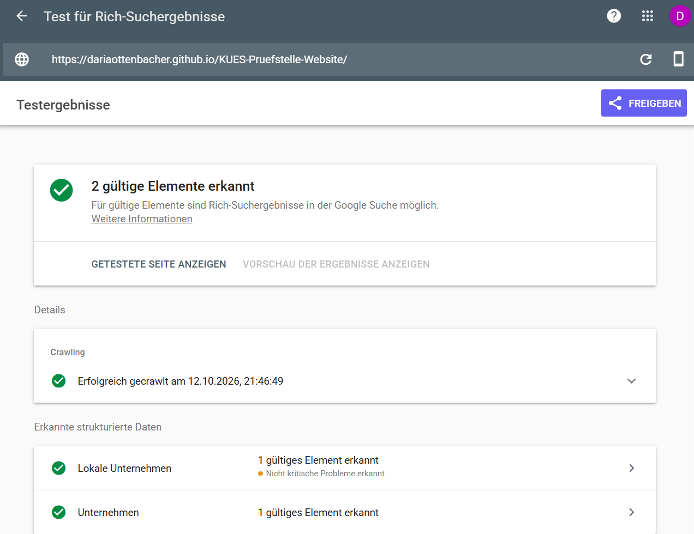
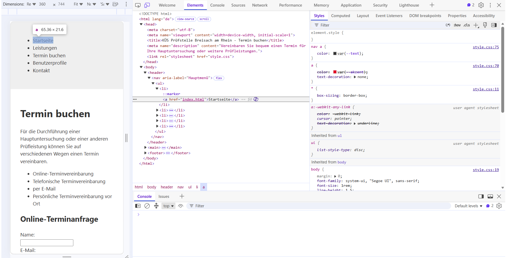
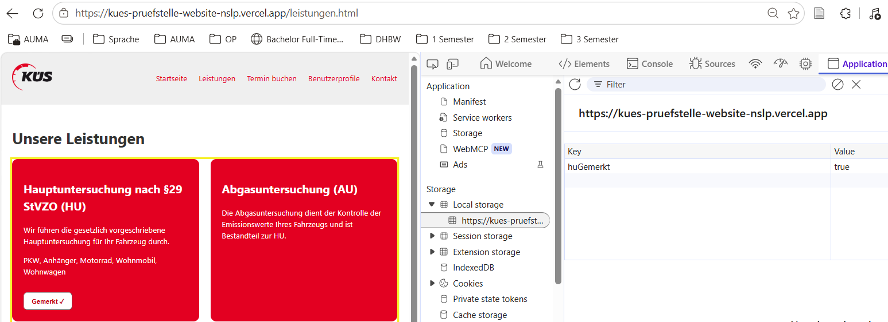

# Dokumentation der Übungsblätter

In dieser Datei werden manche bearbeiteten Aufgaben und Bonusaufgaben des Moduls Web Engineering dokumentiert.

----------------------------------------------------------------------------------

## Übungsblatt 1

### Bonus Aufgabe B: KI-generierte Ideen,  die nicht ausgewählt wurden

1. Fitnessstudio-Finder

Grund für die Ablehnung: Ich nutze bereits Hansefit, worin eine integrierte Suche und ein Tracker für Studios enthalten sind. Ein weiteres System dieser Art bietet für mich keinen praktischen Mehrwert.

2. Wetter-App

Grund für die Ablehnung: Das Konzept ist zwar klassisch, jedoch gibt es bereits unzählige Wetter-Anwendungen auf dem Markt. Zudem bieten viele bestehende Schnittstellen oft ungenaue Vorhersagen, weshalb das Thema für ein eigenes Projekt wenig Anreiz bot.

3. Rezeptdatenbank

Grund für die Ablehnung: Die Idee war grundsätzlich ansprechend. Ich habe mich jedoch dagegen entschieden, da ich ein Projekt umsetzen wollte, das auf einen konkreten persönlichen Anwendungsfall zugeschnitten ist und von mir im Alltag tatsächlich genutzt werden kann.

4. Kinofilm-Finder

Grund für die Ablehnung: Ich fand, dass man hier mit viel zu vielen Daten arbeiten müsste. Außerdem müsste man sich ein sehr durchdachtes Konzept überlegen, wie die Suche nach den ganzen verschiedenen Parametern funktionieren soll.

----------------------------------------------------------------------------------

## Übungsblatt 2

### Bonus Aufgabe B: Maschinenlesbarkeit

Für die Startseite wurde ein JSON-LD-Block nach schema.org eingebunden.

Zusätzlich wurde eine llms.txt-Datei im Wurzelverzeichnis erstellt.

Die strukturierten Daten wurden mit dem Google Rich Results Test überprüft.

Ergebnis
Es wurden zwei gültige strukturierte Datenelemente erkannt:

----------------------------------------------------------------------------------

## Übungsblatt 3

### Aufgabe A5: Eine Kollision nachweisen

Die Regeln a { color: var(--akzent); } und nav a { color: var(--text); } stehen in Konflikt (Kollision).
Die Regel nav a { color: var(--text); } gewinnt, weil dieser Selektor spezifischer ist als a.
Je spezifischer ein CSS-Selektor ist, desto höher ist seine Priorität.

### Bonus Aufgabe B: Dark Mode

Der Dark Mode wird über `prefers-color-scheme: dark` gesteuert. Dabei werden nur die Farbvariablen in `:root` angepasst, sodass keine zweite Kopie des Stylesheets notwendig ist.

----------------------------------------------------------------------------------

## Übungsblatt 4

### Aufgabe A3: Drei Komponenten

- Navbar: Wird auf allen Seiten verwendet und hat überall die gleichen Abstände, Farben und Navigationselemente.
- Leistungskarten: Werden auf der Seite „Leistungen“ verwendet. Die Karten haben ein einheitliches Design mit gleichen Abständen, Farben und abgerundeten Ecken.
- Profilbereiche: Werden auf der Seite „Benutzerprofil“ verwendet. Sie haben einen grauen Hintergrund, gleiche Abstände und einen roten Rand auf der linken Seite.

### Bonus Aufgabe B: Umstellung auf Vite und Tailwind-Build

Das Projekt verwendet Vite mit dem Tailwind-Build. Die erzeugte CSS-Datei in `dist/assets/` ist 2,22 kB groß. Sie bleibt klein, weil beim Build nur die tatsächlich verwendeten Tailwind-Klassen berücksichtigt werden.

----------------------------------------------------------------------------------

## Übungsblatt 5

### Aufgabe A3: Lokal und live vergleichen

Die lokale und die veröffentlichte Version sehen gleich aus. Durch die korrekte Vite-Konfiguration werden die Styles und JavaScript-Dateien auch auf GitHub Pages richtig geladen.
Alle fünf HTML-Seiten sind lokal und live erreichbar. Durch die Rollup-Konfiguration werden alle Seiten in den Build-Ordner dist übernommen.
Auf der veröffentlichten Website treten keine 4xx- oder 5xx-Fehler auf. Der base-Pfad und die Verlinkungen wurden passend zum GitHub-Pages-Unterverzeichnis eingerichtet.

### Aufgabe A5: API, CORS und Sicherheit

Für die Kartenfunktion auf der Kontaktseite wird die **Nominatim API von OpenStreetMap** verwendet.  
Über `fetch()` wird die Adresse der KÜS Prüfstelle Breisach am Rhein an Nominatim gesendet, um die geografischen Koordinaten (Breiten- und Längengrad) zu erhalten.

Die erhaltenen Koordinaten werden anschließend mit der JavaScript-Bibliothek **Leaflet** verwendet, um die Position der Prüfstelle auf einer interaktiven Karte darzustellen.

### API-Key

Für die verwendete Nominatim API wird in diesem Projekt **kein API-Key benötigt**.  
Daher muss kein Schlüssel im Quellcode oder im Repository gespeichert werden.

**Key-Art:** kein API-Key / keine Authentifizierung über einen geheimen Schlüssel.

### CORS-Test

Der Zugriff auf die Nominatim API wurde im Browser mit `fetch()` getestet.  
Der Request konnte erfolgreich ausgeführt und die Antwort im Browser verarbeitet werden.

**Ergebnis des CORS-Tests:** erfolgreich.

### Sicherheit des öffentlichen Repositories

Das Repository wurde auf sensible Daten und Secrets überprüft.

Dabei wurde insbesondere geprüft, dass keine:

- API-Keys
- Passwörter
- Zugangsdaten
- Tokens
- sonstigen geheimen Schlüssel

im Repository enthalten sind.

**Ergebnis:** Es wurden keine Secrets gefunden. Das öffentliche Repository enthält keine Zugangsdaten oder andere Informationen, die geheim gehalten werden müssen.

### Bonus Aufgabe B2: Serverless Function online (Vercel)

Für den Zugriff auf The News API wird eine Serverless Function auf Vercel verwendet, damit der geheime API\-Token nicht im Frontend oder im öffentlichen GitHub\-Repository gespeichert werden muss. GitHub Pages reicht für statische Inhalte und öffentliche APIs ohne geheimen Schlüssel aus.

----------------------------------------------------------------------------------

## Übungsblatt 6

### Aufgabe A4: Fehlersuche

#### Fehler 1 – Falscher Selektor für das Eingabefeld

**Symptom:** Das Eingabefeld ("eingabe") konnte durch JavaScript nicht gefunden werden.  
**Ursache:** Im JavaScript wurde `#eingabe` verwendet, im HTML besitzt das Eingabefeld aber die ID `halt`.  
**Fix:** `#eingabe` wurde durch `#halt` ersetzt. 
(Zeile 5, app.js)

#### Fehler 2 – Tippfehler beim Submit-Event

**Symptom:** Beim Klick auf „Hinzufügen“ passierte nichts und die Konsole zeigte zunächst keinen Fehler.  
**Ursache:** Das Event wurde als `sumbit` statt `submit` geschrieben. Dadurch wurde der Event-Handler nie ausgeführt.  
**Fix:** `sumbit` wurde zu `submit` geändert.
(Zeile 11, app.js)

#### Fehler 3 – Selektor für die Liste fehlt

**Symptom:** Beim Hinzufügen erschien die Fehlermeldung `Cannot read properties of null (reading 'appendChild')`.  
**Ursache:** Die Liste wurde in JavaScript nicht mit `document.querySelector()` ausgewählt. Dadurch gab es keine Referenz auf das HTML-Element `#liste`.  
**Fix:** Die fehlende Zeile `const liste = document.querySelector("#liste");` wurde ergänzt.
(Zeile 22-24, app.js)

### Fehler 4 – Tippfehler bei `length`

**Symptom:** Die Haltestellen wurden angezeigt, aber der Zähler zeigte nicht die richtige Anzahl an.  
**Ursache:** Die Eigenschaft `length` wurde als `lenght` geschrieben.  
**Fix:** `lenght` wurde zu `length` geändert.
(Zeile 27, app.js)
---

### Fehler 5 – Zuweisung statt Vergleich

**Symptom:** Der Fehler war auf der Webseite zunächst nicht sichtbar, weil das Eingabefeld durch `required` und `minlength="3"` bereits im HTML validiert wird.
**Ursache:** In `if (name.length = 0)` wird mit `=` eine Zuweisung verwendet. An dieser Stelle soll aber geprüft werden, ob die Länge gleich `0` ist.
**Fix:** Der Zuweisungsoperator `=` wurde durch den Vergleichsoperator `===` ersetzt:
`if (name.length === 0)`
(Zeile 16, app.js)

### Aufgabe A5: KI-Log. Fälle, in denen die KI falsch lag

1. **Fehlersuche A4:** Die KI vermutete bei Fehler 3 eine falsche Groß-/Kleinschreibung. Tatsächlich fehlte die komplette Zeile für `querySelector("#liste")`.

2. **Leere Eingabe:** Die KI übersah zunächst, dass `required` und `minlength="3"` die Eingabe bereits im HTML prüfen. Der Fehler im JavaScript war die Verwendung von `=` statt `===`.

### Aufgabe A6: Sicherheit

Für das Projekt wurden folgende Sicherheitsaspekte überprüft:

1. **Keine Geheimnisse:** API-Keys werden nicht im Quellcode gespeichert. `NEWS_API_TOKEN` und `RESEND_API_KEY` sind als Environment Variables in Vercel hinterlegt.

2. **Fremde Daten als Text:** Daten aus der News-API und Meldungen werden mit `textContent` in das DOM eingefügt. `innerHTML` wird dafür nicht verwendet.

3. **Eingaben prüfen:** Formulareingaben werden unter anderem mit `required`, `minlength`, passenden Eingabetypen und zusätzlichen JavaScript-Prüfungen validiert. Bei der Terminbuchung sind außerdem keine vergangenen Termine erlaubt und Termine können nur mittwochs oder freitags angefragt werden.

4. **HTTPS:** Die veröffentlichte Website sowie die API-Aufrufe laufen über HTTPS.

5. **GitHub-Sicherheit:** Für den GitHub-Account ist 2FA aktiviert. Im Repository sind Dependabot, Secret Protection und Push Protection aktiviert.

6. **Saubere Fehlermeldungen:** Nutzer erhalten verständliche Fehlermeldungen ohne Stacktraces oder interne technische Details.

**XSS-Test:** Die Eingabe `` wurde in den Eingabefeldern getestet. Es wurde kein JavaScript ausgeführt.

### Bonus Aufgabe B: localStorage

Auf der Seite „Leistungen“ kann die Hauptuntersuchung mit der Schaltfläche **„Merken“** markiert werden.

Der Zustand wird mit `localStorage` im Browser gespeichert. Dadurch bleibt die Auswahl auch nach einem Neuladen der Seite erhalten.

Beim Start der Seite wird der gespeicherte Wert wieder ausgelesen. Ungültige oder veraltete Werte werden abgefangen und aus dem `localStorage` entfernt, damit die Seite weiterhin funktioniert.

**Test:**
- Leistung mit „Merken“ ausgewählt → nach `F5` weiterhin als „Gemerkt ✓“ angezeigt.
- Ungültigen Wert `abc` manuell im `localStorage` eingetragen → nach dem Neuladen wurde der ungültige Wert abgefangen und die Seite funktionierte weiterhin.
