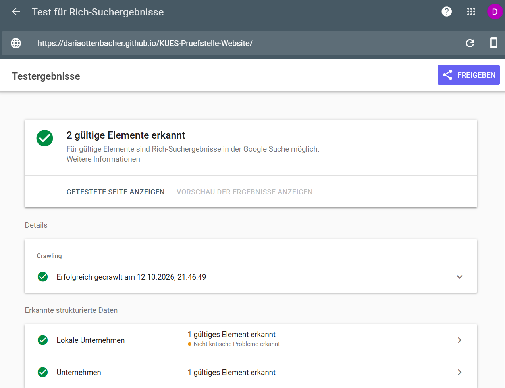
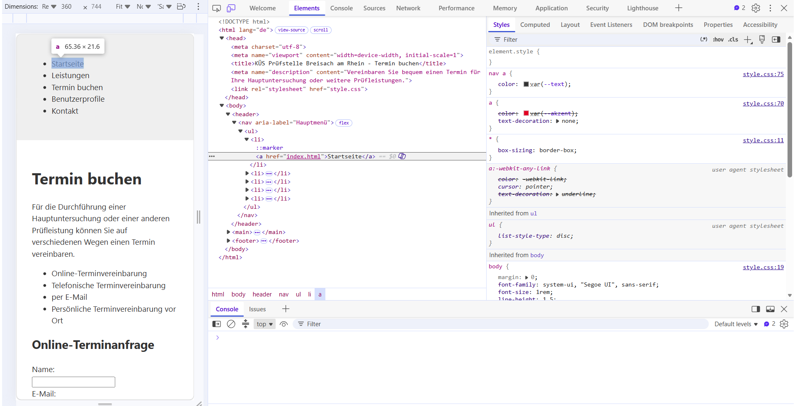

# KUES Prüfstelle Website

## Live-Demo

Die Website ist hier erreichbar:
https://dariaottenbacher.github.io/KUES-Pruefstelle-Website/

## Projektidee

Im August 2026 hat mein Mann im Rahmen einer Prüforganisation der KÜS eine KFZ-Prüfstelle eröffnet.

Da bisher noch keine eigene Website vorhanden ist, möchte ich im Rahmen des Moduls Web Engineering an der DHBW eine Website für die Prüfstelle erstellen. So kann ich das im Studium Gelernte direkt an einem echten Projekt anwenden und gleichzeitig etwas Nützliches für das Unternehmen entwickeln.

## Geplante Inhalte

Die Website soll Informationen über die Prüfstelle, die angebotenen Dienstleistungen sowie die Kontaktmöglichkeiten enthalten.

Außerdem möchte ich eine Online-Terminreservierung umsetzen, bei der Kunden verfügbare Dienstleistungen auswählen und einen Termin buchen können.

## Weitere Ideen

Im weiteren Verlauf des Projekts könnte die Website um zusätzliche Funktionen erweitert werden, zum Beispiel:

- Kundenregistrierung
- HU/AU-Erinnerung per Email oder Post
- Verwaltung von Terminen
- Online-Bewerbungen
- Upload von Lebensläufen und Bewerbungsunterlagen für Bewerber

## Team

- Daria Ottenbacher

----------------------------------------------------------------------------------

## Übungsblatt 1
## Bonus Aufgabe B: 
# KI-generierte Ideen,  die nicht ausgewählt wurden

1. Fitnessstudio-Finder

Grund für die Ablehnung: Ich nutze bereits Hansefit, worin eine integrierte Suche und ein Tracker für Studios enthalten sind. Ein weiteres System dieser Art bietet für mich keinen praktischen Mehrwert.

2. Wetter-App

Grund für die Ablehnung: Das Konzept ist zwar klassisch, jedoch gibt es bereits unzählige Wetter-Anwendungen auf dem Markt. Zudem bieten viele bestehende Schnittstellen oft ungenaue Vorhersagen, weshalb das Thema für ein eigenes Projekt wenig Anreiz bot.

3. Rezeptdatenbank

Grund für die Ablehnung: Die Idee war grundsätzlich ansprechend. Ich habe mich jedoch dagegen entschieden, da ich ein Projekt umsetzen wollte, das auf einen konkreten persönlichen Anwendungsfall zugeschnitten ist und von mir im Alltag tatsächlich genutzt werden kann.

4. Kinofilm-Finder

Grund für die Ablehnung: Ich fand, dass man hier mit viel zu vielen Daten arbeiten müsste. Außerdem müsste man sich ein sehr durchdachtes Konzept überlegen, wie die Suche nach den ganzen verschiedenen Parametern funktionieren soll.

----------------------------------------------------------------------------------

## Übungsblatt 2
## Bonus Aufgabe B: 

Bonus: Maschinenlesbarkeit
Für die Startseite wurde ein JSON-LD-Block nach schema.org eingebunden.

Zusätzlich wurde eine llms.txt-Datei im Wurzelverzeichnis erstellt.

Die strukturierten Daten wurden mit dem Google Rich Results Test überprüft.

Ergebnis
Es wurden zwei gültige strukturierte Datenelemente erkannt:

Lokales Unternehmen
Unternehmen

----------------------------------------------------------------------------------

## Übungsblatt 3
## Aufgabe A5:

Die Regeln a { color: var(--akzent); } und nav a { color: var(--text); } stehen in Konflikt (Kollision).
Die Regel nav a { color: var(--text); } gewinnt, weil dieser Selektor spezifischer ist als a.
Je spezifischer ein CSS-Selektor ist, desto höher ist seine Priorität.

## Bonus Aufgabe B: 

Der Dark Mode wird über `prefers-color-scheme: dark` gesteuert. Dabei werden nur die Farbvariablen in `:root` angepasst, sodass keine zweite Kopie des Stylesheets notwendig ist.

----------------------------------------------------------------------------------

## Übungsblatt 4
## Aufgabe A3:

- Navbar: Wird auf allen Seiten verwendet und hat überall die gleichen Abstände, Farben und Navigationselemente.
- Leistungskarten: Werden auf der Seite „Leistungen“ verwendet. Die Karten haben ein einheitliches Design mit gleichen Abständen, Farben und abgerundeten Ecken.
- Profilbereiche: Werden auf der Seite „Benutzerprofil“ verwendet. Sie haben einen grauen Hintergrund, gleiche Abstände und einen roten Rand auf der linken Seite.

## Bonus Aufgabe B: 

Das Projekt verwendet Vite mit dem Tailwind-Build. Die erzeugte CSS-Datei in `dist/assets/` ist 2,22 kB groß. Sie bleibt klein, weil beim Build nur die tatsächlich verwendeten Tailwind-Klassen berücksichtigt werden.

----------------------------------------------------------------------------------

## Übungsblatt 5
## Aufgabe A3: Vergleich zwischen lokaler und veröffentlichter Version

Die lokale und die veröffentlichte Version sehen gleich aus. Durch die korrekte Vite-Konfiguration werden die Styles und JavaScript-Dateien auch auf GitHub Pages richtig geladen.
Alle fünf HTML-Seiten sind lokal und live erreichbar. Durch die Rollup-Konfiguration werden alle Seiten in den Build-Ordner dist übernommen.
Auf der veröffentlichten Website treten keine 4xx- oder 5xx-Fehler auf. Der base-Pfad und die Verlinkungen wurden passend zum GitHub-Pages-Unterverzeichnis eingerichtet.